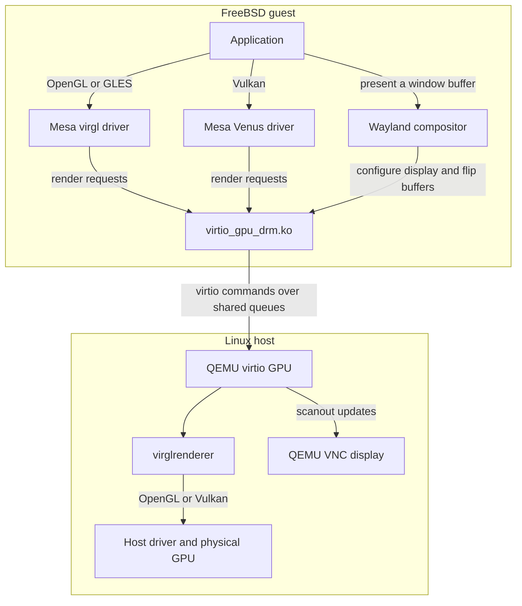

# How graphics works in a FreeBSD 15.1 QEMU guest

Suppose you open a Wayland window in FreeBSD and draw a triangle. The
application chooses the vertices and colors, a GPU turns them into pixels,
and the desktop puts the window on the screen. In this setup the **guest**
is the FreeBSD VM, the **host** is the Linux machine running QEMU, and the
physical GPU belongs to the host. This guide follows that triangle across
the boundary. To build the VM first, use the [installation walkthrough](README.md#freebsd-152-qemu-install-with-virtio-gpu--hyprland).

## From a draw call to a visible window

1. **Draw.** An application calls a graphics API such as OpenGL. A shader
   is a small program that runs on the GPU. For the triangle, a vertex
   shader places its corners and a fragment shader supplies colors. Mesa,
   a userspace library in the guest, encodes the work for the virtual GPU.
2. **Execute.** Mesa asks the guest kernel driver to submit the work.
   QEMU receives it and passes it to the host renderer. The host graphics
   driver programs the physical GPU, which writes the pixels into an image
   buffer. An application can render and read back this buffer without
   opening a window.
3. **Present.** A Wayland application makes its finished buffer available
   to the compositor. Hyprland or KWin (Plasma) combines the visible
   windows into the desktop. The compositor can itself use Mesa to draw.
   Under Plasma X11, clients talk to Xorg, KWin composites windows, and
   Xorg normally manages the display.
4. **Display.** Kernel Mode Setting (**KMS**) chooses the output mode and the
   framebuffer to show. A framebuffer describes the memory holding the image
   and how to interpret its pixels. Changing to the next framebuffer is a
   *page flip*. In this VM the *scanout* is the image feeding QEMU's virtual
   monitor. QEMU can send changes to a VNC viewer on the host. [FreeBSD Handbook on Wayland](https://docs.freebsd.org/en/books/handbook/wayland/)

## Which machine owns which device?

On a physical FreeBSD machine, DRM (Direct Rendering Manager) provides
interfaces for rendering and display control. For example, on a supported
modern Radeon, Mesa's `radeonsi` driver prepares OpenGL work and the
FreeBSD `amdgpu` kernel module submits it to the installed GPU. In this VM,
the corresponding pair is Mesa virgl and the `virtio_gpu_drm` module.
Their target is a device implemented by QEMU. That design is called
*paravirtualization*. Both sides know the device is virtual and agree on
how to exchange commands. [FreeBSD Handbook on graphics drivers](https://docs.freebsd.org/en/books/handbook/x11/#x-graphic-card-drivers) ·
[QEMU virtio GPU device models](https://www.qemu.org/docs/master/system/devices/virtio/virtio-gpu.html)

| Where | Device or setting | Who uses it and why |
|---|---|---|
| FreeBSD guest | `/dev/dri/renderD128` (typical) | Mesa opens the render node to allocate buffers and submit rendering work. An offscreen test can use this node alone. |
| FreeBSD guest | `/dev/dri/card0` (typical) | The display server opens the primary node for KMS. An active desktop session needs permission to control the display and receive input. The Hyprland setup uses `seatd` to grant that access. |
| Linux host | `RENDER_NODE=/dev/dri/renderD128` or `renderD129` | The launcher gives this path to QEMU's EGL display backend to select a physical GPU. On the test host, 128 was Radeon and 129 was NVIDIA. Match the PCI address under `/dev/dri/by-path` to `lspci -nn` on your own host. |
| Linux host | `virtio-vga-gl` or `virtio-gpu-gl-pci` | Both expose an accelerated virtio GPU. The first also offers VGA compatibility. On the tested QEMU machine, `virtio-gpu-gl` is an alias for the second. |

For example, starting QEMU on host `renderD129` can give you a guest
`renderD128` backed by an RTX 3090. Each kernel numbers its own devices.
The `-display egl-headless` option lets QEMU use the host GPU without
opening a local display window. KVM accelerates guest CPU execution. GPU
acceleration comes from the graphics drivers and renderer. [VM launcher](run.sh)

You will also see **EGL**, **GBM** and **GLX** in guest test output. EGL
lets an application set up an OpenGL or GLES context and choose where to
draw. GBM (Generic Buffer Manager) lets software allocate graphics buffers
on a DRM device. The offscreen test uses GBM and EGL together. GLX connects
OpenGL to the X Window System, which is why the X11 test uses `glxinfo`.

## How the FreeBSD driver takes control

An early boot console can already show text using a framebuffer. Desktop
applications need a driver that also handles render requests. The install
guide sets `hint.vtgpu.0.disabled="1"` so FreeBSD's base framebuffer
driver leaves the device available, then loads `virtio_gpu_drm` during
system startup. Three modules cooperate in this branch.

| Guest module | Responsibility |
|---|---|
| `dmabuf.ko` | Supplies shared buffers and fences. A fence lets another user of a buffer wait until earlier work on it has finished. |
| `drm.ko` | Supplies the common DRM interfaces, including device nodes, graphics memory objects and KMS helpers. |
| `virtio_gpu_drm.ko` | Implements the GPU-specific operations, translating buffer, draw-submission and display requests into virtio messages. |

Start reading the port at `virtio_gpu_drm_attach()`. FreeBSD's device
framework, **newbus**, calls it when the driver binds to the GPU. It
negotiates feature bits with the device and connects the FreeBSD transport
to the ported DRM driver. **LinuxKPI** provides interfaces that let ported
Linux kernel code run inside the FreeBSD kernel. The transport adapter is
split into two C files because each kernel's headers define their own
`struct virtqueue`. The native file owns FreeBSD queues and interrupts.
The adapter presents the queue operations expected by the DRM code.
[Native attach code](../../drivers/gpu/drm/virtio/virtgpu_freebsd.c) ·
[Linux virtio adapter](../../drivers/gpu/drm/virtio/linux_virtio.c) ·
[Module build inputs](../../virtio/Makefile)

## Follow one OpenGL submission in the source

1. Mesa's **virgl** driver batches drawing commands. It uses a DRM
   `ioctl`, a system call that sends a typed request through an open device
   file. At `virtio_gpu_execbuffer_ioctl()`, the guest driver looks up the
   referenced buffers, handles synchronization dependencies and submits
   the batch for the application's rendering context. A context keeps a
   client's rendering state across submissions. [Guest ioctl definitions](../../include/uapi/drm/virtgpu_drm.h) · [Submission handler](../../drivers/gpu/drm/virtio/virtgpu_submit.c)
2. `virtio_gpu_cmd_submit()` packages the batch as
   `VIRTIO_GPU_CMD_SUBMIT_3D`. The **control virtqueue** is a shared ring
   of descriptors pointing to request and reply memory. The guest adds
   descriptors, then signals QEMU to inspect the queue (a *kick*). A
   separate cursor queue carries pointer image and position updates.
   The adapter keeps device-readable request segments separate from
   device-writable reply segments, even when they occupy adjacent memory.
   [Wire messages](../../include/uapi/linux/virtio_gpu.h) · [Queue implementation](../../drivers/gpu/drm/virtio/virtgpu_vq.c)
3. In QEMU, `virgl_cmd_submit_3d()` reads the batch and hands it and its
   context ID to `virgl_renderer_submit_cmd()`. For a virgl context,
   virglrenderer translates the encoded draw into host OpenGL work. The
   host driver handles the physical GPU. [QEMU 11.1.3 host implementation](https://github.com/qemu/qemu/blob/v11.1.3/hw/display/virtio-gpu-virgl.c) · [Mesa virgl driver](https://docs.mesa3d.org/drivers/virgl.html)
4. Submission is asynchronous. The CPU can queue another draw while the
   GPU is busy. For fenced work, the host reports the fence ID on
   completion. The guest handles the queue interrupt and drains replies
   in `virtio_gpu_dequeue_ctrl_func()`. It signals the corresponding
   fence so a waiting reader can safely use the result. [Guest fence handling](../../drivers/gpu/drm/virtio/virtgpu_fence.c)

## How an image reaches the desktop

Inside DRM, **GEM** (Graphics Execution Manager) tracks the lifetime of a
buffer. A handle identifies that object for one open DRM file. The virtio
protocol uses a separate *resource ID* so the guest and QEMU can refer to
the same resource in later commands. **PRIME** lets a client export a
buffer as a DMA-BUF file descriptor and pass it to another guest process.
For example, a compositor can import a window's buffer to sample its pixels.
It also needs the format and *stride*, the distance in bytes from the
start of one row to the next. [GEM objects](../../drivers/gpu/drm/virtio/virtgpu_object.c) · [PRIME sharing](../../drivers/gpu/drm/virtio/virtgpu_prime.c)

An *atomic* KMS update describes related display changes together. For
one output, the connector represents the monitor, the display controller
(CRTC) drives its mode, and the primary plane selects its framebuffer.
In `virtio_gpu_primary_plane_update()`, changing the framebuffer can send
`SET_SCANOUT` or `SET_SCANOUT_BLOB` to QEMU. A resource flush tells QEMU
which rectangle changed. For a simple CPU-drawn buffer, the driver also
transfers the changed pixels to the host. This is how a text console can
work before a desktop has demonstrated any accelerated drawing.
[Display objects](../../drivers/gpu/drm/virtio/virtgpu_display.c) · [Plane updates](../../drivers/gpu/drm/virtio/virtgpu_plane.c)

## What Vulkan adds

A Vulkan program loads a guest driver through the Vulkan loader. The
driver's JSON manifest identifies the installable client driver (**ICD**).
Here the guest ICD is Mesa **Venus**. It serializes Vulkan operations so
the Venus renderer in virglrenderer can issue them through the host Vulkan
driver. For the recorded tests that host driver was RADV on Radeon or
NVIDIA's proprietary driver on the RTX 3090. The guest and host each have
a Vulkan loader and each selects its own ICD. [Mesa Venus protocol and requirements](https://docs.mesa3d.org/drivers/venus.html)

Three pieces make that path work in this branch.

- **Capability discovery and contexts.** At startup the kernel discovers
  the *capability sets* advertised by QEMU. Each describes a rendering
  protocol that the device understands. IDs 1 and 2 identify virgl and
  virgl2. ID 4 identifies Venus. Mesa queries the kernel and uses context
  initialization to select the Venus protocol for the Vulkan client.
  [Capability queries and context initialization](../../drivers/gpu/drm/virtio/virtgpu_ioctl.c)
- **Mappable memory.** A *blob* is a virtio resource whose contents and
  layout are defined by its users, such as the Venus driver. For resources
  that need CPU access, QEMU exposes a host-visible memory window through
  a PCI Base Address Register (BAR). The FreeBSD driver reserves the
  window before negotiating blob support. For a mappable host allocation
  it assigns a range, asks QEMU to map the resource there, and waits for
  confirmation before mapping it into the guest process. This lets the
  guest CPU read results written by the host GPU. [Host-visible resource mapping](../../drivers/gpu/drm/virtio/virtgpu_vram.c)
- **Host and guest setup.** The launcher enables `blob=on,venus=on,hostmem=4G`
  and uses shared guest RAM. The 4 GiB value sizes the mapping window.
  `RENDER_NODE` selects the EGL device, and `QEMU_VULKAN_ICD` picks the
  host Vulkan driver for the corresponding GPU. Inside the guest, the
  test selects the FreeBSD Venus ICD via `VK_DRIVER_FILES`. [Hardware Vulkan setup and build commands](README.md#hardware-vulkan-with-venus)

Presentation adds another step. Vulkan's *swapchain* is a set of images
an application cycles through as it draws and presents. Its window system
integration (WSI) hands those images to Wayland or X11. In an early NVIDIA
run, the guest read back the right data and Vulkan reported successful
presentation, yet the displayed cube had stripes. The host sampled rows
using a different pitch than the producer expected. Aligning the linear
PRIME buffer stride to 32 bytes for that driver fixed the image. Compare
the same desktop before and after the change. [Diagnostic screenshots](results/venus-diagnostics/README.md) · [Mesa patch](mesa-venus-freebsd.patch)

## Observe the stack in a running VM

Start at the first question whose answer you do not know.

| Question | Where to check | What to look for |
|---|---|---|
| Did FreeBSD attach the DRM device? | Guest console: `kldstat`, `ls -l /dev/dri`, and `dmesg \| grep -E 'virtio_gpu\|cap set\|features:'` | Module loaded, primary and render nodes present, and `+virgl` in the feature report. For Venus, also look for `+resource_blob`, `+host_visible`, `+context_init` and capset ID 4. |
| Is the transport processing requests? | Guest console: `sysctl dev.virtio_gpu_drm.0.reaps dev.virtio_gpu_drm.0.queue_state` | Read twice while drawing. An increasing reap count means the guest is collecting completed queue entries. |
| Which OpenGL renderer drew the window? | In the guest desktop, run `glmark2-wayland` on Wayland or `glxinfo -B` on X11. | Look for `virgl` with the expected host GPU. `llvmpipe` or `softpipe` indicates software rendering. A working render node alongside a desktop permission error points you toward the active seat and access to `card0`. |
| Which Vulkan device can an application use? | In the Venus-enabled guest, run `vulkaninfo --summary`. | Look for `DRIVER_ID_MESA_VENUS`, the expected vendor, and an integrated or discrete GPU. The default loader can also enumerate a CPU device. |

To check the pixels, the GLES test draws 1,000 frames offscreen and reads
each one back. The Vulkan test fills a mapped buffer on the GPU and
checks every word after completion. A separate cube test presents to a
real desktop, and the VNC capture shows the resulting scanout. Choose the
test that exercises the part of the stack you changed. [GLES test](render-smoke.c) · [Vulkan test](vulkan-smoke.c) · [Desktop checks](guest-proof.sh)

The recorded FreeBSD 15.1 run covers two host GPUs, two QEMU device
models and three desktops under each of two kernel sanitizers. KASAN
checks memory accesses for errors such as use after free. KMSAN tracks
uses of uninitialized memory. The report includes the FreeBSD WITNESS
lock-order warning seen during mapping teardown, along with the renderer
logs and screenshots for the 24 cases. [Validation report and coverage limits](results/venus.md)
